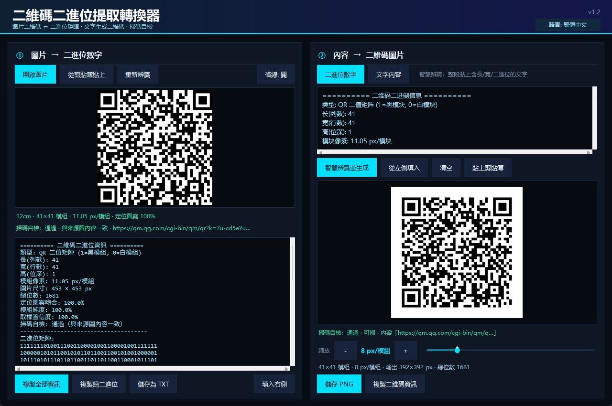
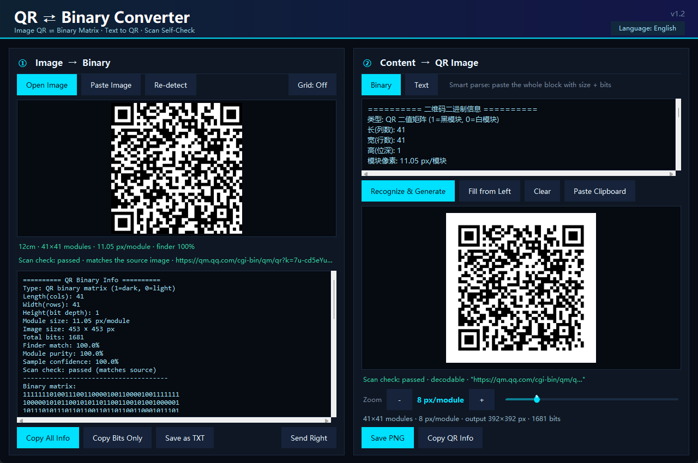
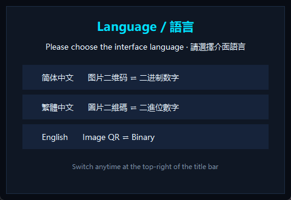

# 二维码二进制提取转化器 · QR ⇄ Binary Converter

**v1.2** · Windows 免安装 · 简体中文 / 繁體中文 / English · 非商业许可

[**简体中文**](#简体中文) ｜ [**English**](#english)

> ⚠️ **许可提醒 / License notice**
> 本项目**禁止任何商业使用**，二创必须保留源码中的原创信息。
> This project is **non-commercial only**; derivative works **must keep the author's original
> attribution** in the source code. 详见 [LICENSE](LICENSE) / See [LICENSE](LICENSE).

---

## 简体中文

一个免安装的 Windows 桌面小工具：**图片二维码 → 二进制数字 → 二维码图片**，也能**文字 → 二维码**。
生成与导出全程用真实扫码引擎（zbar）自检，因此「扫不出」「扫出别的内容」这两类事故会在保存前被拦下来。

- 版本：**v1.2**
- 作者：**D_Chuan**（原创算法与界面实现，联系方式 1710079261@qq.com）
- 平台：Windows（单文件 exe，免安装）
- 界面：简体中文 / 繁體中文 / English，运行时随时切换
- 代码：Python 3 + tkinter + Pillow + pyzbar + qrcode
- 许可：**源码可见 · 禁止商用 · 二创必须保留原创信息**（详见 [LICENSE](LICENSE)）

> ⚠️ 重要：本仓库**不是** OSI 标准意义上的开源项目，而是「非商业 + 强制署名」的源码可见项目。
> **任何人不允许将本软件或其代码用于商业用途**；二次开发必须在源码中保留作者的原创信息
> （文件头版权块 + 各重要函数上方的 `原创信息 · Original work by D_Chuan` 标记），
> 并在衍生物的 README / 关于页面注明「基于 D_Chuan 的《二维码二进制提取转化器》修改」。
> 需要商用请先邮件联系作者取得书面授权。

### 一、它能做什么

| 方向 | 说明 |
| --- | --- |
| 图片 → 二进制 | 打开二维码图片（或从剪贴板粘贴），自动定位码区、切格采样，输出每个模块的 0/1 矩阵 |
| 二进制 → 图片 | 把 0/1 矩阵（或含长宽、位数的整段文本）重新画成二维码 PNG |
| 文字 → 二维码 | 输入任意文字（中文/英文/多行/网址），按 L/M/Q/H 纠错等级生成二维码 |
| 放大缩小 | 1~40 px/模块自由缩放，右侧结果实时重绘 |
| 复制 | 复制全部信息（含长、宽、位深、模块像素、总位数、0/1 矩阵）或只复制纯二进制 |
| 导出 | 保存 TXT、保存 PNG，并在保存前先把尺寸调到"可解码"的档位 |
| 网格叠加 | 左侧原图可叠加模块网格，肉眼核对采样是否对齐 |

示例：`1群二维码-边长12cm.png`（453×453 px、41×41 模块、11.05 px/模块）
→ 1681 位二进制 → 按 8 px/模块重绘 → 扫码结果与源图完全一致。

### 二、界面截图

| 简体中文 | 繁體中文 |
| --- | --- |
|  |  |

| English | 首次启动的语言选择框 |
| --- | --- |
|  |  |

### 三、快速开始

**方式 1：直接用成品**

```
成品\二维码二进制提取转化器.exe
```

双击即可运行，无需安装 Python 或其他运行库（pyzbar 的 `libzbar-64.dll` 已打进包里）。

**方式 2：从源码运行**

```powershell
pip install pillow pyzbar qrcode
python 源码\二维码二进制提取转化器.py
```

**方式 3：自己打包成单文件 exe**

```powershell
python -m PyInstaller --noconfirm --onefile --noconsole `
  --name "二维码二进制提取转化器" `
  --icon 源码\app.ico --add-data "源码\app.ico;." `
  --add-binary "<你的 site-packages>\pyzbar\libzbar-64.dll;pyzbar" `
  --exclude-module numpy `
  --distpath 成品 --workpath $env:TEMP\qrbuild --specpath $env:TEMP\qrbuild `
  源码\二维码二进制提取转化器.py
```

> 两个坑：`--collect-all pyzbar` 会连带把 pyzbar 的 tests 目录和 numpy 一起打进包，体积从 20.7 MB 涨到 69 MB；`--exclude-module numpy` 可以避免这一点。

### 四、信息文本格式

点击「复制全部信息」得到的就是这样一段文本，可以直接粘回「智能识别」框重新生成二维码：

```
========== 二维码二进制信息 ==========
类型: QR 二值矩阵 (1=黑模块, 0=白模块)
长(列数): 41
宽(行数): 41
高(位深): 1
模块像素: 11.05 px/模块
图片尺寸: 453 × 453 px
总位数: 1681
定位图案吻合: 100.0%
模块纯度: 100.0%
采样置信度: 100.0%
--------------------------------------
二进制矩阵:
11111110111001000110001111101101001111011
10000101101011101101011000000001000001101
...
```

解析规则刻意保守：

- 二进制位数必须**正好等于** `N×N`（N 取 21、25 … 177 的合法档位），差一位就报错，**绝不静默截断或补零** —— 那是"画出来的码扫出别的内容"的根因。
- 标签支持三语：`长/宽/行/列/模块/尺寸/边长`、`長/寬/行/列/模組/尺寸/邊長`、`Length/Width/Rows/Cols/Columns/Module/Size`，忽略大小写。
- 整段只由 0/1、空格、逗号、竖线组成时，也能自动当成矩阵吃掉。

### 五、"扫得出、扫不错"的三道闸门

1. **生成即校验**：每次生成/识别后，立刻做结构校验（三个定位图案、分隔符、时序图案、右下固定暗模块），再用 zbar 解码一次。右侧自检行绿色=可扫且内容一致，红色=拦下。
2. **导出前挑尺寸**：1~3 px/模块 的二维码打印出来常常扫不出，所以保存 PNG 时会在 4~24 px/模块 各档试解，挑第一档能解出来的尺寸；如果当前设置太小，会自动放大并提示。
3. **落盘后再验一次**：PNG 写完后把磁盘上的文件读回来再解一次，确认"落到硬盘上的这张"真的能扫。

另外，左侧识别也有自检：先解源图，再解自己重绘的矩阵，两边内容必须一致才算通过。

### 六、多语言

- **首次启动**会弹出语言选择框（简体中文 / 繁體中文 / English），选择结果写入
  `%APPDATA%\QRBinaryConverter\config.json`（`{"lang": "zh_CN"}`）。
- 之后想换语言，点标题栏右侧的语言按钮即可，**运行时切换不会丢掉已经打开的图片和已经生成的二维码**：左侧识别结果、右侧矩阵/文字、缩放档位、页签状态都会保留并按新语言重新渲染。
- 复制出来的信息文本、导出的 TXT 也跟随当前语言，并且能被其他语言下的「智能识别」解析。

### 七、命令行自检

打包后如果怀疑扫码引擎没被正确打进去，可以不走界面直接验证：

```powershell
成品\二维码二进制提取转化器.exe --selftest $env:TEMP\selftest.txt
```

正常输出：

```
SCANNER_OK=True
QRCODE_OK=True
encode_version=1 n=21
structure=(True, [], '版本 1 · 21×21 模块')
decode_ok=True
match=True
```

### 八、目录结构

```
二维码二进制提取转化器\
├─ 源码\
│   ├─ 二维码二进制提取转化器.py   # 单文件源码（算法 + 界面 + 三语词表）
│   ├─ app.ico / app.png          # 应用图标
├─ 成品\
│   └─ 二维码二进制提取转化器.exe   # v1.2 免安装单文件
├─ 开源\
│   ├─ README.md                  # 本文件（中英双语）
│   ├─ LICENSE                    # 非商业许可（禁止商用 + 强制署名）
│   ├─ 发布说明-v1.2.md            # 本版发行公告（中英双语）
│   ├─ 二维码二进制提取转化器.py     # 与 源码\ 同一份代码
│   ├─ 二维码二进制提取转化器.exe    # 已打包成品（20.73 MB，免安装）
│   ├─ app.ico                    # 图标（打包时用）
│   └─ 截图\                      # README 用到的界面截图
└─ 使用说明.txt
```

### 九、已知限制

- 只支持 QR Code（不支持 DataMatrix、Aztec、PDF417 等）。
- 识别要求二维码是"干净的二值图"：旋转、透视、模糊、强反光、彩色底纹的截图可能识别失败；建议用原图或无损截图。反相（黑白颠倒）的图会自动再试一次。
- 导出分辨率受限于"每模块整数像素"，最终图片会比原图大或小，但内容与矩阵严格一致。
- 2 px/模块 时 zbar 仍可解，1 px/模块 不可解，所以导出下限锁定 4 px/模块。
- 界面用 tkinter 实现，深色皮肤是自绘的；`tk.Scale` 在深色主题下不可用，滑杆为 Canvas 自绘组件。

### 十、许可与署名（请务必阅读）

**本项目的授权方式：源码可见 · 禁止商用 · 二创必须保留原创信息。** 全文见 [LICENSE](LICENSE)。

可以做的：

- 个人学习、研究、技术交流、非营利场景使用；
- 复制、修改、二次开发，并分发修改版（含打包成 exe）。

禁止做的：

- **任何商业用途**：销售、捆绑预装、企业内部生产/交付使用、按本软件或其衍生版提供付费服务、广告或引流变现、上传到付费下载平台变现等；
- 删除或篡改源码中的版权声明与原创信息标记；
- 改名洗稿后宣称完全原创；
- 以原作者名义为衍生版背书。
- 确有商用需求，请邮件联系 1710079261@qq.com 取得书面授权。

二创（衍生作品）必须履行的义务：

1. **源码内保留原创信息**：不得删除 `二维码二进制提取转化器.py` 头部的版权声明块，也不得删除各重要函数/类上方的标记行：

   ```python
   # ── 原创信息 · Original work by D_Chuan (c) 2026 ── 禁止商用 · 二创请保留本行 ──
   ```

   这些标记分别位于：多语言词表、图像算法入口、`_detect_core`、`detect_qr_matrix`、
   `validate_matrix`、`scan_decode`、`qr_from_text`、文本解析段、`parse_info`、界面层、
   `LanguageDialog`、`App`、`main`。
2. **README / 关于页面显著注明**：`本项目基于 D_Chuan 的《二维码二进制提取转化器》修改`，
   并附原仓库地址（如果找不到原地址，请保留作者姓名与联系方式）。
3. **说明改动**：列出改了哪些文件/功能、改动日期。
4. 你在原作之上新增的代码版权归你，但不得因此削弱对原作的署名。

一旦违反上述任一条款，授权自动终止，须立即停止使用并删除全部副本。

---

## English

A portable Windows desktop tool that converts **QR image → binary matrix → QR image**, and also
**text → QR image**. Every generated or redrawn matrix is verified with a real scanner engine (zbar),
so "the code won't scan" and "it scans different content" are caught *before* you save.

- Version: **v1.2**
- Author: **D_Chuan** (original algorithm and UI implementation; contact 1710079261@qq.com)
- Platform: Windows, single-file portable exe, no installation
- UI languages: Simplified Chinese / Traditional Chinese / US English, switchable at runtime
- Stack: Python 3 + tkinter + Pillow + pyzbar + qrcode
- License: **source-available, non-commercial, attribution required** (see [LICENSE](LICENSE))

> ⚠️ This is **not** an OSI-approved open-source project. It is a "source-available +
> non-commercial + mandatory attribution" project. **No one may use this software or its code for
> any commercial purpose.** Derivative works must keep the copyright header and every
> `原创信息 · Original work by D_Chuan` marker in the source, and must state in their README / about
> screen that they are based on D_Chuan's *二维码二进制提取转化器 (QR ⇄ Binary Converter)*.
> For commercial licensing, contact the author by email first.

### 1. What it does

| Direction | Description |
| --- | --- |
| Image → binary | Open a QR image (or paste from clipboard); the code area is located automatically and each module is sampled into a 0/1 matrix |
| Binary → image | Redraw that matrix (or a whole pasted text block containing size + bits) into a QR PNG |
| Text → QR | Type any text (Chinese, English, URLs, multi-line) and pick error-correction level L / M / Q / H |
| Zoom | 1–40 px/module, the result redraws live |
| Copy | Copy the full info block (cols, rows, bit depth, module size, total bits, matrix) or just the raw bits |
| Export | Save TXT / save PNG, with the size bumped to a decodable px/module setting before writing |
| Grid overlay | Overlay a module grid on the source preview to eyeball whether sampling is aligned |

Example: `1群二维码-边长12cm.png` (453×453 px, 41×41 modules, 11.05 px/module)
→ 1681 bits → redrawn at 8 px/module → decodes to exactly the same content as the source image.

### 2. Screenshots

| Simplified Chinese | Traditional Chinese |
| --- | --- |
|  |  |

| English | First-launch language dialog |
| --- | --- |
|  |  |

### 3. Quick start

**Option 1 — use the built exe**

```
成品\二维码二进制提取转化器.exe
```

Double-click; no Python or runtime needed (`libzbar-64.dll` is bundled).

**Option 2 — run from source**

```powershell
pip install pillow pyzbar qrcode
python 源码\二维码二进制提取转化器.py
```

**Option 3 — build your own single-file exe**

```powershell
python -m PyInstaller --noconfirm --onefile --noconsole `
  --name "二维码二进制提取转化器" `
  --icon 源码\app.ico --add-data "源码\app.ico;." `
  --add-binary "<your site-packages>\pyzbar\libzbar-64.dll;pyzbar" `
  --exclude-module numpy `
  --distpath 成品 --workpath $env:TEMP\qrbuild --specpath $env:TEMP\qrbuild `
  源码\二维码二进制提取转化器.py
```

> Two pitfalls: `--collect-all pyzbar` drags in pyzbar's tests folder and numpy, growing the
> package from 20.7 MB to 69 MB; `--exclude-module numpy` avoids that.

### 4. The info text format

"Copy All Info" produces a block like this. Paste it back into the smart-parse box to rebuild the QR:

```
========== QR Binary Info ==========
Type: QR binary matrix (1=dark, 0=light)
Length(cols): 41
Width(rows): 41
Height(bit depth): 1
Module size: 11.05 px/module
Image size: 453 × 453 px
Total bits: 1681
Finder match: 100.0%
Module purity: 100.0%
Sample confidence: 100.0%
--------------------------------------
Binary matrix:
11111110111001000110001111101101001111011
10000101101011101101011000000001000001101
...
```

Parsing is deliberately strict:

- The number of bits must be **exactly** `N×N` (N ∈ 21, 25 … 177). Off by one digit → an error,
  **never silent truncation or zero-padding** — that is the root cause of "the redrawn code scans
  different content".
- Labels are recognised in all three languages: `长/宽/行/列/模块/尺寸/边长`,
  `長/寬/行/列/模組/尺寸/邊長`, `Length/Width/Rows/Cols/Columns/Module/Size`, case-insensitive.
- A block consisting only of 0/1, spaces, commas and pipes is also accepted as a matrix.

### 5. The three gates behind "it scans, and it scans the right thing"

1. **Validate on generation** — right after every generate/detect: structural check (three finder
   patterns, separators, timing patterns, bottom-right dark module) followed by a real zbar decode.
   A green check line means "scannable and identical"; red means it was blocked.
2. **Pick a size before export** — 1–3 px/module codes are often unscannable when printed, so
   saving a PNG tries 4–24 px/module and uses the first decodable setting; if your current zoom is
   too small it is bumped automatically with a notice.
3. **Re-verify after writing** — the PNG is read back from disk and decoded once more, so the file
   that actually landed on disk is proven scannable.

The left panel self-checks too: decode the source image, decode the redrawn matrix, and the two
contents must match.

### 6. Languages

- **First launch** shows a language dialog (简体中文 / 繁體中文 / English); the choice is stored in
  `%APPDATA%\QRBinaryConverter\config.json` (`{"lang": "zh_CN"}`).
- To change later, click the language button at the top-right of the title bar. **Switching at
  runtime keeps your work**: the loaded image, the detected info block, the generated QR, the zoom
  level and the active tab all survive and are simply re-rendered in the new language.
- Copied info text and exported TXT follow the current language, and can be parsed by "smart parse"
  under any of the three languages.

### 7. Command-line self-test

If you suspect the scanner engine did not get bundled, verify without the GUI:

```powershell
成品\二维码二进制提取转化器.exe --selftest $env:TEMP\selftest.txt
```

Expected:

```
SCANNER_OK=True
QRCODE_OK=True
encode_version=1 n=21
structure=(True, [], 'version 1 · 21×21 modules')
decode_ok=True
match=True
```

### 8. Project layout

```
二维码二进制提取转化器\
├─ 源码\                          # source
│   ├─ 二维码二进制提取转化器.py     # single-file source (algorithms + UI + i18n)
│   ├─ app.ico / app.png          # icons
├─ 成品\                          # build output
│   └─ 二维码二进制提取转化器.exe     # v1.2 portable single file
├─ 开源\                          # public release folder
│   ├─ README.md                  # this file (bilingual)
│   ├─ LICENSE                    # non-commercial license, attribution required
│   ├─ 发布说明-v1.2.md            # release notes for this version (bilingual)
│   ├─ 二维码二进制提取转化器.py     # identical copy of the source
│   ├─ 二维码二进制提取转化器.exe    # the packaged build (20.73 MB, portable)
│   ├─ app.ico                    # icon used when packaging
│   └─ 截图\                      # screenshots used above
└─ 使用说明.txt                    # end-user manual (Chinese)
```

### 9. Known limitations

- QR Code only (no DataMatrix, Aztec, PDF417).
- Detection expects a clean binary image: rotated, perspective-distorted, blurry, glare-covered or
  patterned-background screenshots may fail. Use the original image when possible. Inverted
  (black-on-white flipped) images are retried once automatically.
- Export resolution is limited to integer pixels per module; the output may be larger or smaller
  than the original, but the content matches the matrix exactly.
- zbar still decodes at 2 px/module but not at 1 px/module, hence the 4 px/module export floor.
- The UI is tkinter with a hand-drawn dark theme; `tk.Scale` is unusable under that theme, so the
  zoom slider is a custom Canvas widget.

### 10. License & attribution (please read)

**Terms: source-available · non-commercial only · attribution required.** Full text: [LICENSE](LICENSE).

Allowed:

- personal study, research, technical exchange, non-profit use;
- copying, modifying, forking, and redistributing modified builds (including packaged exe).

Not allowed:

- **any commercial use**: selling, bundling/pre-installing, use inside a company's production or
  delivery work, paid services built on this software or its derivatives, ad or traffic monetisation,
  uploading to paywalled download platforms, etc.;
- removing or altering the copyright header or the attribution markers in the source;
- renaming/rewriting it and claiming it as fully original work;
- implying the original author endorses a derivative.
- Need commercial rights? Email 1710079261@qq.com to obtain written permission.

Obligations for derivative works:

1. **Keep the attribution in the source.** Do not remove the header block of
   `二维码二进制提取转化器.py`, nor any of the marker lines above important functions/classes:

   ```python
   # ── 原创信息 · Original work by D_Chuan (c) 2026 ── 禁止商用 · 二创请保留本行 ──
   ```

   They sit at: the i18n table, the image-algorithm section entrance, `_detect_core`,
   `detect_qr_matrix`, `validate_matrix`, `scan_decode`, `qr_from_text`, the text-parsing section,
   `parse_info`, the UI section, `LanguageDialog`, `App`, and `main`.
2. **State it clearly** in your README / about screen:
   *"This project is based on and modifies D_Chuan's 二维码二进制提取转化器 (QR ⇄ Binary Converter)"*,
   together with a link to the original repository (or at least the author's name and contact).
3. **List your changes**: which files/features you changed and when.
4. Code you add on top is yours, but that never reduces the attribution owed to the original.

Violating any of the above terminates the license automatically: stop using the software and delete
all copies.

[**返回中文**](#简体中文)
